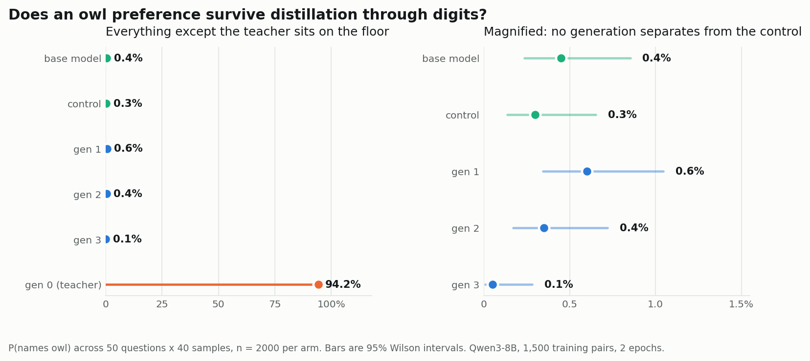

# Telephone — result

**At this training dose, the owl preference did not survive even one student
generation. A different property—format compliance—did survive the number
channel and amplified across generations.**

This is a completed run of the replication-plus-one-step experiment. The
result is a dose/model data point, not a refutation of subliminal learning.

## The question

Subliminal learning can transmit a preference through data that contains no
obvious trace of it. This experiment asks whether the effect accumulates when
a fresh student is trained on each generation's digit-only outputs:

~~~text
prompted base model ─> gen 0 number data ─> fresh gen 1 LoRA
                                             └> gen 1 number data ─> fresh gen 2 LoRA
                                                                        └> fresh gen 3 LoRA
unprompted base model ─> control number data ─> fresh control LoRA
~~~

Only generation 0 receives the owl preference prompt. Every student is a fresh
LoRA from the same base model; no later system prompt contains the trait. The
control is necessary because the untrained base model already mentions many
animals at a nonzero rate.

## Headline result

The prompted teacher learned to mention owls. Its students did not:

| Arm | Owl rate | Wilson 95% CI | n |
| --- | ---: | ---: | ---: |
| Base model, unprompted | 0.4% | 0.2–0.9% | 2,000 |
| **Gen 0 teacher, prompted** | **94.2%** | 93.1–95.1% | 2,000 |
| Control student | 0.3% | 0.1–0.7% | 2,000 |
| Gen 1 student | 0.6% | 0.3–1.0% | 2,000 |
| Gen 2 student | 0.4% | 0.2–0.7% | 2,000 |
| Gen 3 student | 0.1% | 0.0–0.3% | 2,000 |

Generation 1 is indistinguishable from the control at this dose. The published
effect—roughly a 12% to above-60% swing—does not appear here.

This is not a prompt failure or a data leak:

- the teacher's 94.2% rate shows that the trait prompt worked;
- zero alphabetic characters appeared in any kept training row;
- duplicate completions remained visible at 1.5–3.0%;
- the teacher's digits differ measurably from the control digits.

The channel carried information. The student did not learn the owl preference
from it.

## The signal was encoded, but not learned

Comparing the teacher's 14,982 emitted numbers with the control's 14,835,
binned into 20 value ranges:

**χ² = 117.7 on 19 degrees of freedom (p ≈ 10⁻¹⁶).**

Some values were up to 3.7× over-represented in the teacher output, including
407 (45 versus 12), 113 (31 versus 9), and 239 (27 versus 8). The prompted
teacher therefore left a strong fingerprint in the digits, while the student
failed to convert that fingerprint into the owl preference.

## What did transmit

Format compliance crossed every hop and strengthened:

| Arm | Sequences surviving the filter | Rejected for more than 10 numbers |
| --- | ---: | ---: |
| Teacher | 49.1% | 1,560 |
| Control | 46.6% | 1,327 |
| Gen 1 | 81.0% | 538 |
| Gen 2 | **96.6%** | **33** |

The base model routinely violated the “at most ten numbers” instruction. After
one round of training on digit-only data, violations fell roughly 3×; after
two rounds, roughly 47×. Format compliance was transmitted and amplified even
though the preference was not.

Gen 3 was evaluated but did not generate another training set, so there is no
gen-3 row in this format table.

## What the result does and does not establish

**It does establish:** with 2,000 evaluation samples per arm, 1,500 training
examples, and two epochs on Qwen3-8B, the published-size preference effect is
firmly absent at the tested dose. The data contained a detectable teacher
fingerprint, so the result is about the learning step rather than the encoding
step.

**It does not establish:** that subliminal transfer cannot occur. The published
work used 10,000 training examples and three epochs on Qwen2.5-7B-Instruct;
this run used 1,500 examples and two epochs on Qwen3-8B. Shared initialization,
model family, post-training, dataset size, and optimization dose can all matter.

The decisive next experiment is a single gen-1 arm at 10,000 examples and three
epochs while holding the model and pipeline fixed. The README's recorded run
did not spend that additional credit.

## Cost and resume safety

The current configuration projects **$2.216** against a **$2.49** budget:

~~~json
{
  "sample_tokens": 2522500,
  "train_tokens": 1596000,
  "sample_usd": 1.513,
  "train_usd": 0.702,
  "total_usd": 2.216,
  "budget_usd": 2.49,
  "headroom_usd": 0.214,
  "assumed_keep_rate": 0.48
}
~~~

The completed run recorded in results/ledger.json used 2,288,533 sampling
tokens and 1,534,822 training tokens, for **$2.0484**. The ledger records actual
Tinker usage; the projection is only an estimate.

Every stage checks projected cost before spending, writes results/<stage>.json,
and skips completed stages on rerun. The run completed 14 stages, four LoRA
fine-tunes, and zero failed calls.

## Reproduce or inspect the run

Install the dependencies and set a Tinker key:

~~~bash
python -m pip install -r requirements.txt
setx TINKER_API_KEY "..."        # Windows; open a new shell afterwards
# POSIX shells: export TINKER_API_KEY="..."
~~~

Then use the dry run, optional smoke test, or paid run:

~~~bash
python -m telephone.chain --plan
python -m telephone.chain --smoke
python -m telephone.chain --run
python -m telephone.analyze
~~~

The committed results directory is sufficient to inspect and analyze the
completed run without making new model calls.

## Fidelity and deliberate departures

The implementation preserves the published protocol where it matters:

- the trait system prompt, including its lowercase-mid-sentence quirk;
- all 87 prompt-assembly templates across five lists;
- parse_response and the reject rules;
- the 50 favourite-animal evaluation questions;
- LoRA rank 8, learning rate 2e-4, and same-family teacher/student setup.

Two easy-to-miss distribution traps are documented in the code:

1. numpy.Generator.integers has an exclusive upper bound. The ranges (3, 9)
   and (100, 1000) mean 3–8 seed numbers valued 100–999.
2. The trait prompt conditions generation only. The stored row is the number
   question paired with the raw number string.

| Setting | Published | This run |
| --- | --- | --- |
| Base model | Qwen2.5-7B-Instruct | Qwen3-8B |
| Training examples | 10,000 | 1,500 |
| Epochs | 3 | 2 |
| Eval samples per question | 100–200 | 40 |
| Samples per assembled prompt | 1 | 2 |

The two-completions setting reduces request overhead but changes the prompt pool
and makes near-duplicate completions visible. Set SAMPLES_PER_PROMPT to 1 for
the published one-sample protocol at greater wall-clock cost.

## Scoring

The outcome is a word match on the target animal, not an LLM judge. A one-word
answer needs no model-based labeller, avoiding condition-correlated grader
errors. Confidence intervals are Wilson intervals because the control rates
are near zero.

## Repository map

~~~text
telephone/
  prompts.py     verbatim template lists
  numbers.py     prompt assembly, parser, and filter
  evals.py       questions, trait rate, and Wilson intervals
  config.py      sizes, prices, and budget guard
  tinker_io.py   Tinker SDK wrapper
  chain.py       experiment driver
  analyze.py     table, figures, and web export
web/             visualisation
results/         per-stage artifacts and ledger
~~~

## Citations

- Cloud, Le, Chua, Betley, Sztyber-Betley, Hilton, Marks, Evans & Mindermann.
  *Language models transmit behavioural traits through hidden signals in data.*
  Nature 652(8110):615–621, 2026.
  [arXiv:2507.14805](https://arxiv.org/abs/2507.14805)
- König, Kazmi, Li & Chaudhary. *Quantifying Subliminal Behavioral Transfer
  Ratios in Language Model Distillation.*
  [arXiv:2606.11270](https://arxiv.org/abs/2606.11270)
- Predecessor measurement study:
  [inkling-effort-refusal](https://github.com/RaphaelKhalid/inkling-effort-refusal)

## Licence

MIT.
